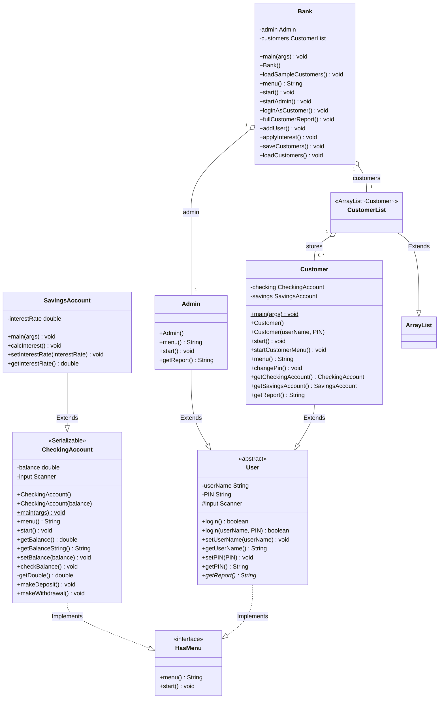

# Serialization in Bank.java
```
// saveCustomers()
initialize saveCustomers{
  try{
    create serialization file for storing customer information

    retrieve customer list from bank

    save list into serialization file

    close file

    print confirmation message that the data was saved
  }

  catch{
    print error message saying customer data could not be saved
  }
} // end saveCustomers

// loadCustomers
initialize loadCustomers{
  try{
    open the created serialization file

    retrieve the customer data list stored inside file

    replace current customer list with list from file

    close file

    print confirmation message saying customer data was loaded
  }

  catch{
    print error message saying no saved customer data was found

    load the sample customers
  }

  catch{
    print error message saying customer data could not be loaded
  }
} // end loadCustomers
```
